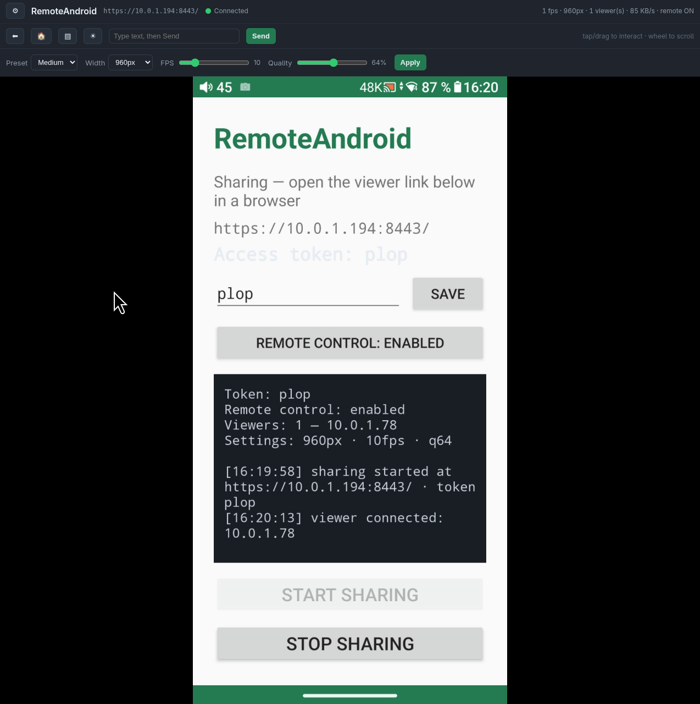

# RemoteAndroid

Partagez l'écran de votre smartphone Android en direct vers n'importe quel
navigateur, sur le même réseau Wi-Fi, via **HTTPS** — et **pilotez le téléphone
à distance** (tap, glisser, boutons Retour/Accueil, saisie de texte).

Tout est embarqué sur le téléphone : aucun cloud, aucun service tiers.

---

## Fonctionnement

```
┌────────── Téléphone Android ──────────┐        ┌──────── Navigateur (PC) ────────┐
│  Écran ─ MediaProjection ─ ImageReader │        │  https://<ip-du-téléphone>:8443 │
│      ─ Bitmap ─ JPEG ──┐               │        │   ┌──────────────────────────┐  │
│                        ▼               │  HTTPS │   │  page HTML (barre d'état) │  │
│   Serveur NanoHTTPD (MJPEG) ───────────┼───────►│   │  │  │
│   bind 0.0.0.0:8443  (TLS auto-signé)  │        │   │  réglages + contrôle      │  │
│  ▲  jeton / cookie                    │        │   └──────────────────────────┘  │
│  └── AccessibilityService (contrôle)  │        └────────────────────────────────┘
└────────────────────────────────────────┘
```

### 1. Capture d'écran

- `MediaProjection` (consentement système) → `VirtualDisplay` → `ImageReader`.
- Les trames sont converties en **JPEG** puis diffusées en **MJPEG**
  (`multipart/x-mixed-replace`) : le navigateur n'a besoin que d'une balise
  ``, aucun décodeur JavaScript.

### 2. Serveur web HTTPS

- Serveur HTTP embarqué **NanoHTTPD** sur le port **8443** (pas besoin de root).
- **Certificat auto-signé** généré à l'exécution (BouncyCastle), avec les IP
  locales du téléphone dans le SAN. Le navigateur affichera un avertissement à
  accepter une seule fois.

### 3. Authentification par jeton

- Un **jeton d'accès** protège toute l'interface web.
- Par défaut, un jeton aléatoire est généré **à chaque session** ; vous pouvez
  définir votre propre jeton dans l'application (il est conservé).
- Au navigateur : page de connexion → saisie du jeton → **cookie sécurisé**
  (`HttpOnly; Secure; SameSite=Strict`) → accès à la diffusion et au contrôle.

### 4. Contrôle à distance (via un service d'accessibilité)

- Taps, balayages, Retour/Accueil, saisie de texte sont injectés par un
  **AccessibilityService** (`dispatchGesture`, `performGlobalAction`).
- L'activation se fait **une fois**, manuellement, dans les réglages
  (voir *Paramètres restreints* ci-dessous).

---

## Fonctionnalités de l'interface web



- **Barre d'état** : connexion (🔴/🟢), fps, résolution, nombre de spectateurs,
  débit (bande passante), état du contrôle à distance (`remote ON/OFF`).
- **Réglages de qualité** (panneau ⚙) : largeur (640 / 960 / 1280 / Source),
  fps, qualité JPEG, presets (Bas / Moyen / Élevé).
- **Contrôle sur l'image** :
  - clic → **tap** ;
  - glisser → **balayage (swipe)** ;
  - molette → **défilement** ;
  - boutons **⬅ / 🏠 / ▤** (Retour / Accueil / Applications récentes) ;
  - champ texte + **Send** (meilleure prise en charge via le champ actif).
- **Multi-spectateurs** : plusieurs navigateurs peuvent regarder en même temps.
- L'application affiche un **journal** : qui est connecté, depuis quelle IP,
  réglages, jeton, etc.

---

## Compilation

Prérequis : JDK 17+, Android SDK (`ANDROID_HOME`), Gradle wrapper inclus.

```bash
./build.sh            # APK debug   -> dist/remote_android-debug.apk
./build.sh release    # APK release -> dist/remote_android-release.apk
./build.sh --clean    # nettoyage avant build
./build.sh --gen-cert # (optionnel) génère un certificat TLS de secours
```

> Note : `release` est signé avec la **clé debug** (outil personnel, pas une
> publication Play Store).

---

## Installation

**Via ADB** :

```bash
adb install -r dist/remote_android-debug.apk
```

Sur **MIUI/Xiaomi**, ADB nécessite d'abord d'activer
**Options développeur → « Installer via USB »** (peut exiger un compte Mi et une
carte SIM).

**Sans ADB** : copiez l'APK sur le téléphone (ex.
`adb push dist/remote_android-debug.apk /sdcard/Download/`) puis ouvrez-le avec
le gestionnaire de fichiers et installez-le.

---

## Utilisation

1. Lancez **RemoteAndroid**.
2. (Optionnel) Définissez un **jeton d'accès** dans le champ dédié.
3. Touchez **« Start sharing »** et acceptez la capture d'écran.
4. L'application affiche l'URL et le **jeton** (aussi dans la notification).
5. Sur l'ordinateur (même réseau Wi-Fi), ouvrez :

   ```
   https://<ip-du-téléphone>:8443/
   ```

6. Acceptez l'**avertissement de certificat** (auto-signé) → saisissez le
   **jeton** → vous voyez l'écran et pouvez le contrôler.

---

## Activer le contrôle à distance

Le contrôle à distance repose sur un service d'accessibilité, à activer **une
seule fois** :

1. Dans l'application, touchez **« Enable remote control »** (ouvre le bon
   écran de réglage), ou allez dans
   **Paramètres → Paramètres supplémentaires → Accessibilité**.
2. Sélectionnez **« RemoteAndroid Remote Control »**.
3. Activez l'interrupteur (MIUI affiche une confirmation avec un compte à
   rebours → **Activer**).

---

## Paramètres restreints (accès restreint) — Android 13+

Sur Android 13 et plus (et souvent MIUI), une application **installée depuis un
fichier APK** (hors Play Store) voit son accès **Accessibilité / Notifications**
bloqué par mesure de sécurité. L'interrupteur apparaît grisé avec
**« Paramètres restreints »**.

### Pourquoi ?

Android empêche une application « sideloadée » d'activer silencieusement
l'accessibilité. Ce n'est **pas un bug** : c'est voulu, et seul l'utilisateur
peut lever la restriction.

### Comment l'autoriser

**Méthode A — depuis l'écran d'accessibilité (recommandée) :**

1. Ouvrez l'écran du service (bouton « Enable remote control » de l'app).
2. En haut, vous voyez *« Paramètres restreints — Pour votre sécurité, ce
   paramètre n'est actuellement pas disponible »*.
3. Touchez le menu **⋮ (trois points)** en haut à droite →
   **« Autoriser les paramètres restreints »** → confirmez **« Autoriser »**.
4. Revenez en arrière et activez l'interrupteur.

**Méthode B — depuis les infos de l'application :**

1. **Paramètres → Applications → Gérer les applications → RemoteAndroid**.
2. Menu **⋮** → **« Autoriser les paramètres restreints »** → **« Autoriser »**
   (sur certaines versions : dans « Autres autorisations »).
3. Retournez dans **Accessibilité** et activez le service.

Après activation, l'écran principal de l'application affiche
**« Remote control: enabled »** en ~1 seconde, et la page web indique
`remote ON`.

### Astuce pour éviter la restriction

Une installation via **`adb install`** est généralement considérée comme une
installation « de session » et **n'est pas** marquée comme restreinte sur
Android 13 stock (sur MIUI, le réglage « Paramètres restreints » peut quand même
apparaître). Il faut alors avoir activé **« Installer via USB »** dans les
options développeur.

---

## Dépannage

| Problème | Cause / solution |
|---|---|
| Avertissement « Connexion non privée » dans le navigateur | Certificat auto-signé : « Paramètres avancés → Continuer ». Vous pouvez aussi importer le certificat dans le poste pour supprimer l'avertissement. |
| `INSTALL_FAILED_USER_RESTRICTED` (adb) | Activer **Options développeur → Installer via USB** (MIUI), ou installer l'APK via le gestionnaire de fichiers. |
| Le flux fige / ne démarre pas | Redémarrez le partage (Stop puis Start). Vérifiez que le téléphone et le PC sont sur le même Wi-Fi. |
| « remote OFF » sur la page web | Activer le service d'accessibilité (voir *Paramètres restreints*). |
| Jeton refusé | Le jeton est sensible à la casse et régénéré à chaque session si vous n'en avez pas défini un. Vérifiez le jeton affiché sur le téléphone. |
| Pas d'images | Autorisez le port 8443 en sortie / sur le pare-feu du PC, et restez sur le même réseau. |

---

## Permissions utilisées

- `INTERNET`, `ACCESS_NETWORK_STATE`, `ACCESS_WIFI_STATE` : serveur web + IP.
- `FOREGROUND_SERVICE` + `FOREGROUND_SERVICE_MEDIA_PROJECTION` : capture
  d'écran en service de premier plan (Android 14+).
- `POST_NOTIFICATIONS` : notification du service.
- Accès **Capture d'écran** et **Accessibilité** : consentements manuels de
  l'utilisateur (pas de permission silencieuse).

---

## Sécurité

- Chiffrement **TLS** (certificat auto-signé = confidentialité + intégrité, mais
  pas d'authentification du serveur : restez sur un réseau de confiance).
- **Jeton** requis pour tout accès web ; comparaison en temps constant.
- Le jeton n'apparaît que sur le téléphone (jamais dans `/status.json`).
- Ne pas exposer le serveur à Internet (liaison sur le réseau local).